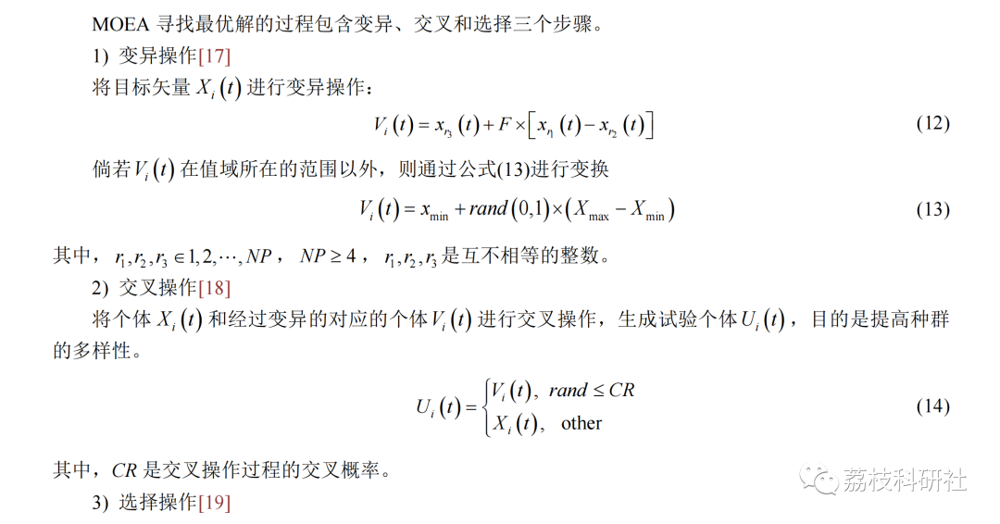
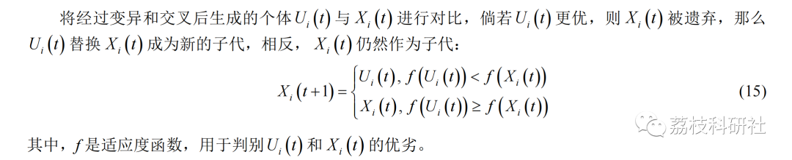
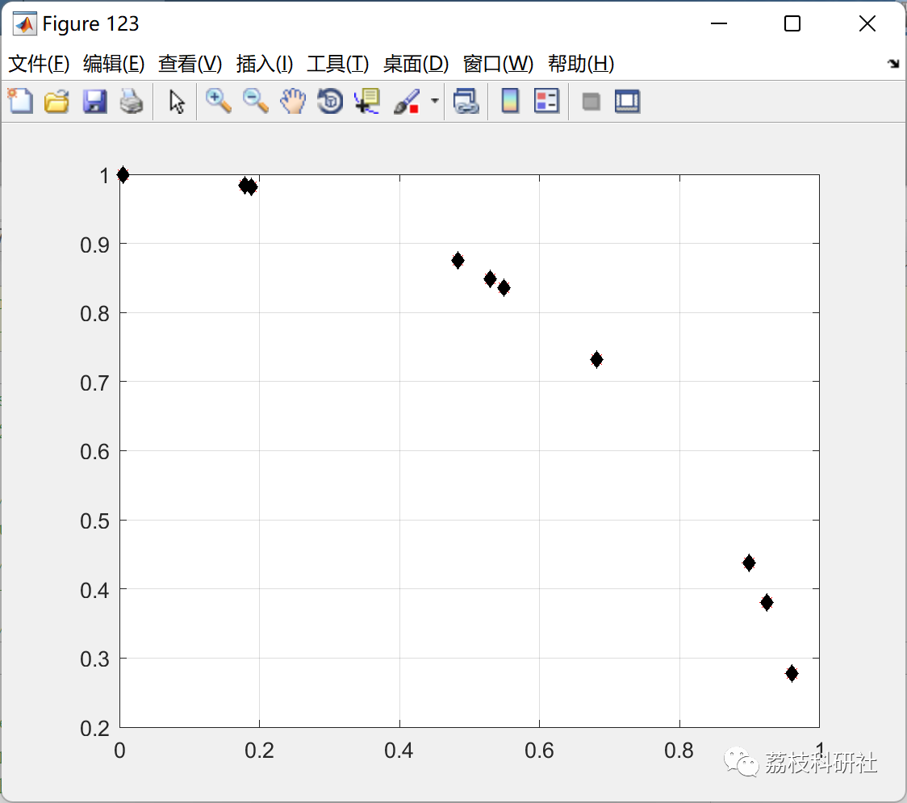

# Multi-Objective Differential Evolution Algorithm (Matlab Code Implementation)

💥💥💥💞💞💞 Welcome to this blog❤️❤️❤️ 💥💥💥
🏆 Bloggers' Advantages: 🌞🌞🌞 The content of the blog strives for thoughtfulness and clarity, making it convenient for readers.
⛳️ Mantra: "A journey of a thousand miles begins with a single step."
Litchi Research Society
Code Collection: Power Systems, Intelligent Algorithms and Applications, Neural Network Prediction, Path Planning, Optimized Scheduling, Workshop Scheduling, Image Processing, Signal Processing...
🎁 Special Section Links:
🌈🌈🌈🌟🌟🌟🌟 Electrical Code Intelligent Algorithms and Their Applications Path Planning Neural Network Prediction Optimized Scheduling Image Processing Workshop Scheduling Signal Processing Romantic Her Thoughts Math Modeling Complete Code Matters
💥1 Overview
This algorithm is modified from the multi-objective differential optimization algorithm.
📚2 Running Results
🎉3 References
[1] Storn, R., Price, K., 1997. Differential evolution: A simple and efficient heuristic for global optimization over continuous spaces. Journal of Global Optimization 11, 341 – 359."
🌈4 MATLAB Code Implementation
Click the article below left corner [Read More]

## Images

<!-- PAYMENT_BLOCK -->

## Get this dataset

- Payment link (Stripe): [Buy now](https://buy.stripe.com/3cs8yP7sY87d0vu9AB)
- Payment QR code: 

<!-- /PAYMENT_BLOCK -->
